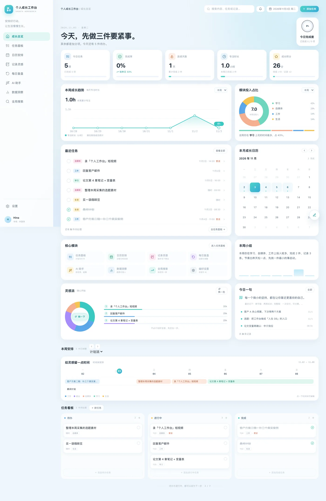

# 个人工作台

一个人的「人生工作台」：每天打开它安排今天，做完记一笔，周末回头看。本地优先，数据在自己电脑上。

清透蓝绿视觉（成长总览风格），Next.js + SQLite，单用户 + 密码登录。



## 现在能做什么

- **今日行动**：今日任务、今日日程、本周完成率；计划派（周甘特 + 三列看板）与灵感派（甜甜圈推荐）两种视角。
- **任务**：增删改、三态（待办 / 进行中 / 完成）、优先级、分类、项目、标签、截止日、安排时间段；卡片上直接看到所属项目（带项目色点）、预估时长、标签；看板可切换三种分组（按状态 / 按项目 / 按分类）；按今天/本周/逾期/项目/**标签**筛选；完成列超过 6 件自动折叠；多选后批量完成 / 设为进行中 / 删除。
- **日历**：时间轴周视图 / 日视图（**0:00–24:00 全天刻度**、凌晨段淡灰底、全天行、重叠日程并排、当前时间线）；**排了时间段的任务也会画在轴上**（斜纹虚线块，和实心日程区分开）；**点空闲块可以就地排一件事**（默认占 60 分钟）；点空白新建、点日程编辑；**日程可拖动改时间与日期**，底部边缘可拉长缩短；任务小卡可拖到某天改截止日；日视图右侧有「本周任务 / 空闲时间 / 今日统计」。
- **记录**：快速记录（任意页面按 `c`）、Markdown 编辑/预览、标签（**点标签即按它筛选**）、置顶、归档、搜索、正文限宽 780 保证长文可读；**底部可以把记录挂到项目、一键变成任务、和已有任务互相建立关联**。
- **搜索**：`⌘K` 快捷搜索（`↑` `↓` 选择、`↵` 打开）；`/search` 页可搜四类内容（任务 / 记录 / 日程 / 复盘），多个关键词用空格分开会要求全部命中，标题命中的排在前面，可按类型与时间范围过滤。
- **复盘**：日复盘 3 问、周复盘（自动汇总本周完成与记录数，**可展开看这周具体完成了哪几件**）；「明天最重要的一件事」可一键存成任务（截止明天、高优先级）；日/周都可用 AI 基于真实数据起稿；历史复盘可以删。
- **AI 助手**：把碎碎念拆成任务（勾选确认后才入库）；DeepSeek / 任意 OpenAI 兼容接口 / 本地 Ollama。设置页内置了几个免费服务商的预设。
- **提醒**：铃铛里列逾期任务、今天到期、12 小时内要做的；任务与日程都可设「提前 5 分钟 / 1 小时 / 1 天」等提前量，重复日程也会按时提醒。
- **每日习惯**：把想每天做的事加进来，点一下打勾；自动算连续天数、本周完成数，最近 7 天可点小圆点补卡（最多往回补 60 天，不能给未来打卡）；今天全部完成会有一句提示。手机端一行两排，底部「更多」里有入口。
- **项目**：项目进度页，一个项目一张卡（进度条 / 完成数 / 颜色 / **目标日期与剩余天数** / 本周完成数），点开看该项目下的任务（**可直接勾完成**）和最近关联的记录；删项目不删任务。
- **重复**：任务与日程都支持「每天 / 每个工作日 / 每周 / 每月」。日程是虚拟展开（库里一条，显示多条）；任务在勾完这一条后自动生成下一次。
- **统计**：近半年热力图（连续天数）、近 30 天趋势、各条线推进、项目推进对比、常用标签。
- **数据**：一键下载完整 `workbench.db` 文件（原地恢复用）、JSON 导出/导入、每日本地备份（保留 14 份）、AI Key 只存本地服务端。
- **反馈**：所有操作即时生效（乐观更新），完成后底部弹提示；删除任务 / 记录 / 日程都可以在提示里点「撤销」。
- **拖拽**：任务面板与首页看板的卡片按住就能拖到别的列改状态；在同一列里拖动会调整前后顺序（一次写完整列，断网不会留半套顺序）。
- **版面**：卡片网格与看板按内容自适应，空列底部是「＋ 添加任务」虚线卡；记录页左栏底部有「本月记录 / 每周记录数 / 常用标签」小面板。
- **任务页收尾区**：看板下面还有「最近七天收尾节奏」（横向进度行）与「刚刚做完的」（最近完成 4 条 + 补位提示），整页一屏铺满、不留大块空白。
- **登录**：单密码进入，页面与 API 全部需登录；会话 cookie 由密码哈希派生签名，改密码即刻踢掉其他设备。
- **日期选择**：日历、任务、搜索三处统一用自绘的日历弹层（桌面浮层 / 手机底部抽屉），不再弹系统原生面板（底层是 react-day-picker）；月份可翻、今天高亮、时间按时/分两个下拉选。
- **所有下拉与勾选**：页面上 13 处选择框全部是自己画的（桌面浮层 / 手机底部抽屉 / 边上打勾），不弹系统菜单；复选框也统一成青绿圆角方块。键盘 `↑` `↓` 可选、`Esc` 关闭。
- **手机上**：底部 4 个主入口 + 「更多」抽屉（设置、项目、复盘、AI、数据、搜索都在抽屉里）；日历默认日视图、周视图是「每天一卡」；记录页是「列表 ⇄ 编辑」两块屏，点进去写、左上角返回；弹窗垂直居中，不会被底部横条挡住；点输入框不会整页放大。
- **出错时**：页面崩溃有错误边界（能重试或回首页），不存在的地址是中文 404 页；任何保存/删除失败都会明确告诉你原因，不会静默失败。
- **设置页**：显示当前镜像的版本号与构建时间（直接读镜像内的 `VERSION` 文件，环境变量改不动它）；「立即更新」点完会**真的告诉你结果**（正在拉镜像 / 容器重建中 / 已更新到哪个版本 / 三分钟没变），不是只回一句「已触发」。
- **大屏**：窗口超过 2460px 时侧栏与主区整体居中收成 2400 宽的带，不再右侧空一大块；记录正文单独限宽 780，一行不会长到读不下去。

## 手机上安装（PWA）

不用装原生 App，把网页「固定到主屏幕」就像个 App 了：有自己的图标、全屏没地址栏、独立窗口，点图标直接打开。以后网页更新了，主屏上这个入口下次打开就是新版，一份代码不用多端同时维护。

- **iPhone / iPad**：用 Safari 打开 `https://workbench.lbuding.com` → 底部「分享 ↑」→ 「添加到主屏幕」→ 添加。
- **安卓**：用 Chrome 打开同一个网址 → 菜单 → 「安装应用 / 添加到主屏幕」。
- 前提是走 `https://workbench.lbuding.com` 这个 HTTPS 地址（局域网用 `http://IP:3100` 打开装不了，因为 Service Worker 要求安全上下文）。

几点要心里有数：

- 关掉后收不到系统推送（提醒只在页面开着时弹）。
- 断网打不开、数据也拿不到（数据都存在 NAS 上），断网时会显示一张「当前没有网络」的兜底页。
- 打开瞬间有极短的白屏。
- 这不是应用商店里那种要审核、能上架的原生 App，本质是全屏网页；但日常用起来体验基本一致。

## 登录

首次打开会要求设置一个密码（至少 6 位，只存在本机数据库里，没有找回入口）；之后每次打开都要输一次。

- 会话保持 24 小时，过期后自动跳回登录页，登录完回到原来那页。
- 同一 IP 10 分钟内输错 6 次会锁 10 分钟。
- 改密码在「设置 → 登录密码」；改完这台设备不用重新登录，其他设备上的旧会话会立刻失效。
- 侧栏底部有退出按钮。密码不是多用户体系，只有一个密码，用来挡住「别人打开这个地址」。

## 快速开始

要求 Node.js 22+（本项目在 Node 24 上开发；使用 Node 内置 `node:sqlite`，无需编译原生模块）。

```bash
pnpm install
pnpm dev          # http://localhost:3100
```

生产模式：

```bash
pnpm build
pnpm start        # http://localhost:3100
```

端口固定 3100（3000 常被其他本地应用占用，可在 `package.json` 的 scripts 里改）。

## 数据在哪

- 主数据库：`data/workbench.db`（SQLite，WAL 模式）
- 自动备份：`data/backups/workbench-YYYY-MM-DD.db`，保留最近 14 份
- 全新数据库首次启动会自动建表并写入一组示例数据（7 个任务、4 个日程、3 条记录），方便直接看效果；「设置 → 清空全部数据」后不会再次写入。

备份发生在每天第一次打开应用时；也可以直接复制 `data/workbench.db`。

## 配置 AI（可选）

打开「设置」：

- Base URL：`https://api.deepseek.com`
- 模型：`deepseek-chat`
- API Key：`sk-...`（只写入本地 SQLite，服务端调用，不回传浏览器）

点「测试连接」验证。也可以填本地 Ollama 的 OpenAI 兼容地址，例如 `http://127.0.0.1:11434/v1`，模型填 Ollama 里的模型名。

没有 Key 时，任务、日程、记录、复盘、统计等全部功能照常可用，只有 AI 拆任务 / 复盘起稿 / 连接测试不可用。

## 技术结构

```
app/
  layout.tsx            根布局（html/body + 每日备份触发）
  login/                登录页（独立于应用外壳）
  (app)/                需登录的应用区：layout.tsx 验签 + 侧栏外壳
    page.tsx            今日行动
    tasks/ calendar/ notes/ projects/ review/ ai/ stats/ settings/ search/
    error.tsx           路由级错误边界（界面崩了能重试）
  not-found.tsx         404 页
  api/                  tasks notes events projects reviews search settings export export-db import reminders ai auth
components/             Dashboard, TasksPage, CalendarApp, NotesApp, ProjectsApp, ReviewApp, AiApp, StatsApp,
                        SettingsApp, Sidebar, TopBar, CommandPalette, QuickCapture, ReminderBell, TaskModal,
                        DateField, SearchDates, SearchType, Select, RepeatFields, AppShell, LoginApp,
                        Blobs, Toast, Confirm, DragGhost
middleware.ts           粗筛 cookie（真实验签在 (app)/layout.tsx，因为 edge 读不到 SQLite）
lib/auth.ts             scrypt 密码哈希 + HMAC 会话 cookie + requireAuth()
lib/db.ts               schema、迁移、seed、设置、每日备份
lib/use-tasks.ts        任务本地状态、乐观更新、删除撤销
lib/use-pointer-drag.ts 通用指针拖拽（鼠标 5px/触屏长按 220ms 起拖）
lib/ai.ts               OpenAI 兼容调用
lib/repeat.ts           重复规则（每天/工作日/每周/每月）与日程虚拟展开
lib/search.ts           四类内容搜索（多词 AND、标题加权）
lib/api.ts              统一请求封装（网络异常/非 2xx/401 跳登录）
data/                   SQLite 与备份（不入库）
prototypes/             早期 UI 原型（A/B/C 深色 + D 暖白手账，仅存档）
docs/screens/           README 用的截图（webp，压缩过）
开发文档.md             需求、范围、数据模型、里程碑
```

技术栈：Next.js 15 App Router、React 19、TypeScript、Tailwind v4（只用了 preflight，样式全在 `app/globals.css`）、`node:sqlite`、zod、date-fns、react-day-picker、lucide-react。

## 边界（V1 不做）

- 不做多用户 / 角色权限、云同步、原生 App、团队协作（只有单一入口密码）。
- 关掉页面后不会推送提醒（需要部署 + Web Push，V2）。
- 知识库只预留接口（`external_ref` 表），不内置知识库。
- 习惯、记账、学习、自媒体、项目等模块暂不做，当前是通用底座。

## 开发说明

- 所有页面 `force-dynamic`，数据实时读 SQLite。
- `node:sqlite` 返回 null-prototype 行对象，直接传给客户端组件会报 `Only plain objects...`。用 `lib/db.ts` 的 `rows<T>()` / `row<T>()` 取数即可，不要自己写 `.map(r => ({...r}))`（早期 13 处重复已统一）。
- 所有请求走 `lib/api.ts` 的 `api()`，失败会抛带中文文案的 `ApiError`，用 `errText(e)` 转成提示语。别再直接 `fetch` —— 那样网络一断就静默失败。
- 数据库迁移在 `getDb()` 里用 `ensureColumn` 做轻量 ALTER，新增字段无需手动迁移。
- 类型检查：`pnpm exec tsc --noEmit`；构建：`pnpm build`。
- 任务的本地状态与撤销逻辑集中在 `lib/use-tasks.ts`；提示由 `components/Toast.tsx` 提供，弹窗由 `components/Confirm.tsx` 提供，拖拽由 `lib/use-pointer-drag.ts` + `components/DragGhost.tsx` 提供。
- **做拖拽/删除类自动化测试时，务必用 `WORKBENCH_DATA_DIR=/tmp/xxx` 指向临时库并另起端口跑**，不要对真实 `data/workbench.db` 操作。

## 部署

两种方式，**推荐 Docker（绿联 NAS）**。

### 方式一：Docker / 绿联 NAS（当前线上）

完整步骤见 [部署指南-NAS.md](部署指南-NAS.md)。一句话版本：

1. NAS 上拉 `ghcr.io/lengbuding1991/personal-workbench:latest`（公开包，匿名可拉）；
2. 粘贴 [docker-compose.nas.yml](docker-compose.nas.yml)，一次起 `workbench` + `watchtower` 两个容器；
3. 以后本机 `pnpm push` → GitHub Actions 构建 arm64 镜像 → watchtower 拉取重建（默认 24 小时兜底轮询；想立刻更新就在「设置 → 更新工作台」点按钮，会通过 watchtower 的 HTTP API 主动触发）。
4. GHCR 只保留最新 2 个镜像版本，每次构建后自动清理。

数据在 NAS 的 `/volume1/docker/workbench/data`（容器里是 `/data`），重建容器不影响。
`watchtower` 只更新打了 `com.centurylinklabs.watchtower.enable=true` 标签的容器，不碰 NAS 上其它服务。

### 方式二：普通 Linux 服务器（阿里云那套，已弃用但脚本还在）

见 [部署指南.md](部署指南.md)。`deploy/bootstrap.sh` 装 Node、nginx、证书并注册 systemd，跑在 `127.0.0.1:3200`。
**注意**：2G 内存的机器构建 Next 会 OOM（exit 137），脚本虽然加了 swap + flock + 内存预检，但实测仍会拖垮整机 —— 这就是迁到 NAS 的原因。

## 推送到 GitHub

这台机器到 `github.com:443` 的 TLS 握手会被中断，`git push` 会挂死到超时；但 `api.github.com` 是通的。
所以推送走 Git Data API：

```bash
npm run push            # 或 node scripts/push-to-github.mjs
node scripts/push-to-github.mjs --dry   # 只看要推哪些提交
```

Token 依次从 `$GH_TOKEN`、`~/.dsh/workbench-token`、`~/.dsh/deng-stock-token` 找（文件里只放 token，`chmod 600`）。
远端 sha 与本地 sha 不同，对应关系记在 `.git/github-pushed.json`，支持增量推送。
